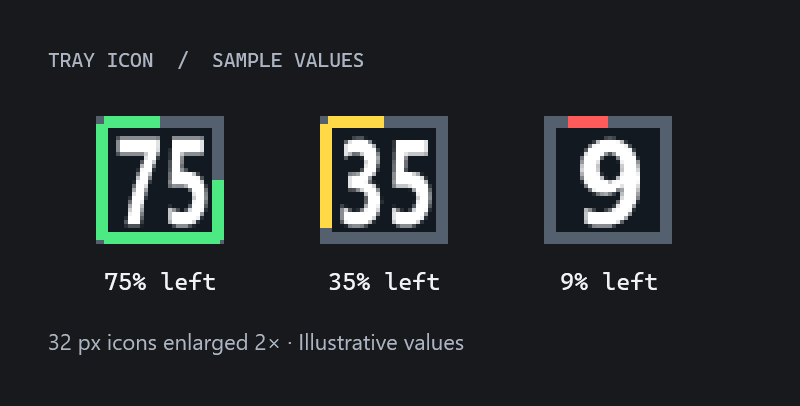
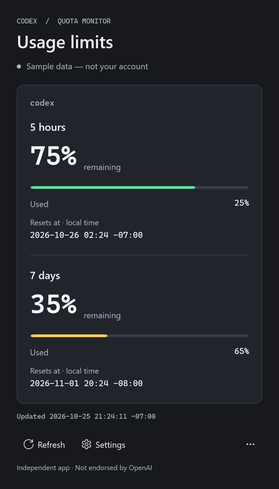
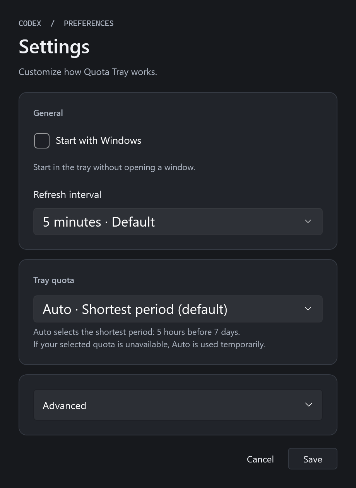

# Codex Quota Tray

An independent Windows 11 desktop app that displays **server-reported remaining Codex usage limits** in the notification area (system tray). This is not an official OpenAI product and is not endorsed by OpenAI or independently security-audited.

## At a glance

**Remaining usage, right in your tray.** Open details for every quota and reset time, or choose your preferred quota and refresh interval in Settings.

<p align="center">
  
</p>

| Usage details | Settings |
|:---:|:---:|
|  |  |

These images are rendered from the app's actual UI with synthetic sample data; they contain no account usage or credentials. Window title bars are omitted. Tray icons are enlarged for readability; demo mode itself displays `D` in the tray.

## Download

**[Download v0.1.1 for Windows 11 x64](https://github.com/thegreatkingbear/codex-quota-tray/releases/tag/v0.1.1)** — fixed-folder installer prerelease, with the .NET runtime included.

Choose `CodexQuotaTray-v0.1.1-win-x64.zip` under Assets, extract the entire ZIP, exit any running Quota Tray, and double-click **Install.cmd**. Confirm installation, then use **Codex Quota Tray** in the Start menu. No administrator privileges are required. To view real usage, you need an installed, signed-in official Codex client. Demo mode works without an account.

This preview is unsigned and Windows may show an unknown-publisher warning. See the release notes for checksums and testing limitations.

## Run

The installer always uses `%LOCALAPPDATA%\Programs\CodexQuotaTray`. To update, exit the app and run **Install.cmd** from the next extracted release. Preferences and the existing startup choice are preserved; enabled startup is repointed to the fixed path. Old identified tray records are backed up and cleaned up. Use the Start menu shortcut, not the EXE in the downloaded `app` subfolder, to keep one tray identity.

The installer keeps the previous files in a `CodexQuotaTray.backup-*` sibling folder for recovery. After checking the update, you may remove that backup. It does not delete old portable copies or shortcuts; stop using them after migration. Registry backups are saved under `%LOCALAPPDATA%\CodexQuotaTray\maintenance-backups`.

For source development, the local build remains at `artifacts/win-x64/CodexQuotaTray.App.exe`; keep that entire folder together.

- Launch the app to show the details window and tray icon. If Windows hides the icon, look in the hidden-icons menu beside the clock.
- **Tray number:** the selected quota's remaining percentage, rounded down. The default selects the shortest server-reported period, such as 5 hours before 7 days. Choose a specific quota under **Settings → Tray quota**. If that quota disappears, the app temporarily uses Auto and restores your selection when it returns. The details window retains decimal precision. `D` means demo data; `?` means unknown or stale data.
- **Square border:** remaining usage fills counterclockwise from 12 o'clock. The gray consumed portion grows clockwise. Remaining usage above 50% is green, 20–50% is yellow, and below 20% is red. Unknown or stale values have no colored graph.
- **Left-click:** open details. **Right-click:** Refresh now / Show details / Settings / Exit.
- The details window has compact Refresh and Settings buttons. Its X button or Esc hides the window. To quit, choose **… → Exit Codex Quota Tray** or **Exit** in the tray menu.
- **Settings:** General contains **Start with Windows** and a refresh interval of 2, 5, 10, 15, or 30 minutes; the default is 5 minutes. Startup is opt-in and starts the app in the tray without opening a window. Click **Save** to apply changes. **Cancel** discards them.
- **Advanced:** the executable path, SHA-256 fingerprint, and Demo mode are collapsed by default. Enable Demo mode here or launch `CodexQuotaTray.App.exe --demo`. Sample values are always labeled `Sample data — not your account`.

The details window adjusts its height to its contents and expands its width within limits for long names. Content that exceeds the screen scrolls. It follows the Windows light/dark app theme and presents remaining usage, used percentage, and local reset times in cards.

Codex in the official desktop installation is discovered automatically after checking its Windows signature and OpenAI publisher. For other installations, select a trusted official `codex.exe` under Advanced and verify its path and SHA-256. `.cmd`/`.ps1` wrappers and arbitrary PATH execution are unsupported. You may need to reselect the executable after a Codex update.

## Startup with Windows

Enable **Start with Windows** and click **Save** to register startup for the current user. Disable it and save to remove the registration. The app manages only its own `CodexQuotaTray` entry under `HKCU\Software\Microsoft\Windows\CurrentVersion\Run`; it requires no administrator privileges. The checkbox reads the actual registration rather than duplicating its state in the settings file.

If Windows blocks the app in Startup apps, enable it there too. After moving the app folder, turn startup off and save, then turn it on and save again to register the new path. Startup registration is unavailable for development launches through `dotnet.exe` and excessively long executable paths.

## Data and security

Quota periods are not hardcoded. The app supports periods other than 5 hours and 7 days, single or multiple quotas, and missing fields. Remaining usage is calculated only from the server's valid `usedPercent`; unknown values are never treated as zero. Reset timestamps are converted from Unix seconds to local time with the UTC offset applicable on that date.

The only outgoing protocol methods are `initialize`, `initialized`, and `account/rateLimits/read`. The app does not read authentication files or browser cookies, or ask for passwords or tokens. It has no HTTP client, listening port, developer-operated backend, telemetry, or automatic updater. **The child Codex process may communicate with OpenAI.** The method allowlist does not impose an OS-level read-only sandbox on Codex.

Only preferences are saved to `%LOCALAPPDATA%/CodexQuotaTray/settings.json`: refresh interval, demo mode, selected executable path and hash, and a hashed tray quota selection key. Usage values, account IDs, credentials, and raw responses are not persisted or logged. The child process tree is cleaned up after each query. Failures mark previously retrieved values as Stale and increase the retry interval up to 30 minutes. Only one refresh runs at a time, and manual refreshes are limited to one every 5 seconds.

## Build and test

Development was verified on Windows 11 x64 with .NET SDK **10.0.403**, pinned in `global.json`. The SDK is not part of the source distribution. In the development environment, the official Microsoft SDK ZIP was verified using SHA-512 and extracted to `.tools/dotnet`.

```powershell
./build.ps1          # Release build and 100 automated checks
./build.ps1 -Publish # Self-contained folder and per-file SHA-256 checksums
```

With the SDK installed normally, you can also run:

```powershell
dotnet build -c Release
dotnet run --project tests/CodexQuotaTray.Tests -c Release
dotnet publish src/CodexQuotaTray.App -c Release -r win-x64 --self-contained true -o artifacts/win-x64
```

Tests use an executable harness with no external test packages. **`dotnet test` alone does not run them.** The harness exits with a nonzero code on failure. It launches a fake server in a real child process to check initialization, the method allowlist, excessive output, timeouts, cancellation, and process cleanup. Normal tests require neither Codex nor an account login.

## Troubleshooting

| Status | Action |
|---|---|
| CODEX_NOT_FOUND | Install official Codex or select its executable in Settings. |
| UNTRUSTED_EXECUTABLE | Verify the path and hash, then reselect the official binary. |
| AUTH_REQUIRED | Sign in through the official Codex CLI, then refresh. Never enter tokens into this app. |
| TIMEOUT / SERVER_ERROR | Check Codex and your connection, then refresh. |
| PROTOCOL_UNSUPPORTED | Update the CLI and verify that usage queries are supported for your authentication mode. |
| Stale | These values came from an earlier query. Check the Updated timestamp and refresh. |

To remove the app, first disable startup in Settings and save if it was enabled. Choose Exit, then delete `%LOCALAPPDATA%\Programs\CodexQuotaTray` and the Codex Quota Tray Start menu shortcut. You may also remove the settings folder above. There is no service or automatic updater.

## Verification and release status

See [test results](docs/TEST_RESULTS.md), [design decisions](docs/DECISIONS.md), and the [security model](docs/SECURITY.md). Live queries and the UI have been tested on Windows 11. Sleep/resume, Explorer restart, all DPI/multi-monitor combinations, and clean-account testing remain incomplete. The first public release is an **unsigned prerelease**, with the remaining verification gaps disclosed. Project source is licensed under [MIT](LICENSE); bundled Microsoft runtime components retain their own licenses and notices.

`SHA256SUMS.txt` checks the integrity of files in the build folder. Checksums alone do not prove source-to-binary correspondence or reproducible builds. Runtime, SDK, build path, and signing differences can affect output; bit-for-bit reproducibility has not been verified. Release packages are built from a committed source revision using `./package-release.ps1`. The bundled installer applies manually downloaded packages only; no automatic download-and-execute mechanism is included.
